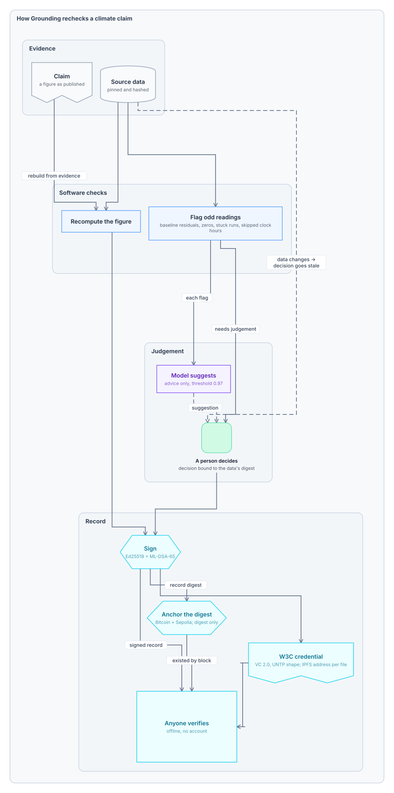

# Grounding

Evidence-first climate verification workspace for the IEEE ClimateChain Global Hackathon 2026.

> **A figure is only as good as the work it can show.**

## Why Grounding exists

A climate figure is asked to carry a lot: the meter readings, the emission factor, the readings someone dropped and why, the model that flagged them, the person who decided, what could not be checked, and whether anything changed since. It arrives as one number, and none of that travels with it.

Most of that work can be recorded, recomputed or checked by software. Grounding makes it travel with the number.

```text
Can software recompute or check this?
   ├─ yes             → rechecked in your browser, from the evidence
   ├─ needs judgement → a model may suggest; a named person decides,
   │                    and the decision is bound to the exact data
   └─ cannot be checked → the claim says so: "Needs evidence"
```



Each box links to the code that does it ([`evidence-flow.ofk`](docs/architecture/evidence-flow.ofk); open [`evidence-flow.openflow.json`](docs/architecture/evidence-flow.openflow.json) in OpenFlowKit to edit). The module model in [`grounding.ofk`](docs/architecture/grounding.ofk) cites the file and line behind every dependency; `openflowkit drift . --model docs/architecture/grounding.ofk` reports when the code moves away from it.

## Principles

1. **Recompute, don't restate.** The building figure is rebuilt from 2,160 hourly meter readings and the EPA grid factor.
2. **A model suggests; a person decides.** The model's advice never changes a claim's status.
3. **Software enforces the policy.** The advice threshold (0.97) and the energy cap (120 MWh asked, 100 MWh allowed) are set in code.
4. **A decision is tied to the data it was made on.** Change one reading and the decision goes stale.
5. **Say what could not be checked.** Three of the six claims read "Needs evidence".
6. **Show a gap rather than hide it.** The satellite detector finds 11,974 ha burned against 18,664 ha in the reference labels.
7. **Anyone can verify a record,** with no account and no server.
8. **Every check is measured.** The advice threshold was set on 296 labelled readings: at 0.97, 88% of suggestions were labelled bad.

**What it does not prove.** Rechecking is not assurance: Grounding reports findings from rechecking the evidence, close to the agreed-upon procedures of ISO 14064-3 Annex C, and gives no assurance opinion of the kind ISSA 5000 governs. Signing keys are made in the browser for one record, so a signature does not prove who signed. A company's own disclosure can be linked to its source and what it rests on, but it cannot be recalculated.

**The experiment.** How much of a climate claim can software check before a person has to decide? On six real claims: three rechecked, three needing evidence, and each record says which is which.

**Climate claims that show their work.**

## Demo

The integrated judging demo is the fastest way to see the product:

```bash
npm install
npm run demo:build
npm run demo:serve
```

Open `http://localhost:4173`.

The demo combines measured outputs from Building MRV, Energy-EVA forecasting, HLS Earth observation, BatteryLife DPP, CarbonPlan registry reconciliation, and real CaDI-confirmed public disclosure sources. It also exposes the capability-aware WebMCP surface when `document.modelContext` is available.

See [docs/judging-demo.md](docs/judging-demo.md) for the 3–5 minute presentation flow.

> Submission blocker: this repository is currently private. The hackathon requirements tracked in [#1](https://github.com/helenkwok/grounding-climate/issues/1) require a public GitHub (or equivalent) repository before final submission.

The project is organised around verifiable climate claims rather than tokens:

```text
evidence
→ deterministic/model analysis
→ claim
→ verification
→ attestation
→ optional commitment/ledger anchor
```

Development roadmap: see [#17](https://github.com/helenkwok/grounding-climate/issues/17).

## Current work

- [#6](https://github.com/helenkwok/grounding-climate/issues/6) — evidence-first domain model
- [#14](https://github.com/helenkwok/grounding-climate/issues/14) — source rights manifest
- [#18](https://github.com/helenkwok/grounding-climate/issues/18) — crypto-agile trust layer
- [#8](https://github.com/helenkwok/grounding-climate/issues/8) — provenance/attestation lifecycle
- [#7](https://github.com/helenkwok/grounding-climate/issues/7) — capability-aware WebMCP surface

## External data policy

Raw external datasets and reports are not committed unless redistribution rights are explicit.

The authoritative project audit is [`sources/rights-manifest.json`](sources/rights-manifest.json). Unknown rights fail closed: use the upstream source, but do not redistribute its bytes.

- [Source-rights policy](docs/source-rights.md)
- [Generated source attribution](docs/source-attribution.md)

Run:

```bash
npm run check
```

This builds/tests the core domain model, validates the source-rights manifest, rejects unauthorized content under `data/external/`, and checks that generated attribution is current.

## Building MRV prototype

The first analytical module is documented in [docs/building-mrv.md](docs/building-mrv.md).

```bash
npm run building:prepare -- --out data/external/bdg2/demo --hours 2160
npm run building:analyze -- \
  --dir data/external/bdg2/demo \
  --factor <kgCO2e-per-kWh> \
  --factor-geography "<matching geography>" \
  --factor-source "<original source URL>"
```

The grid factor is deliberately not guessed from anonymised BDG2 site IDs. The CLI records the supplied factor source as provenance and produces a Grounding case, report, and evidence root.

## Battery DPP prototype

The BatteryLife/CALB digital-product-passport slice is documented in [docs/battery-dpp.md](docs/battery-dpp.md). It reruns the CALB Dummy life-prediction baseline from the pinned v1 release (which does **not** exactly reproduce the published summary row; the discrepancy is recorded), builds a traceable SOH/RUL decision-support passport from one processed battery, and demonstrates evidence-root failure after a cycle-capacity tamper.

## Licence

Grounding's code and documentation are licensed under the [Apache License 2.0](LICENSE); see [NOTICE](NOTICE). Third-party data keeps its own licence, recorded in [sources/rights-manifest.json](sources/rights-manifest.json) and listed in [docs/source-attribution.md](docs/source-attribution.md).
